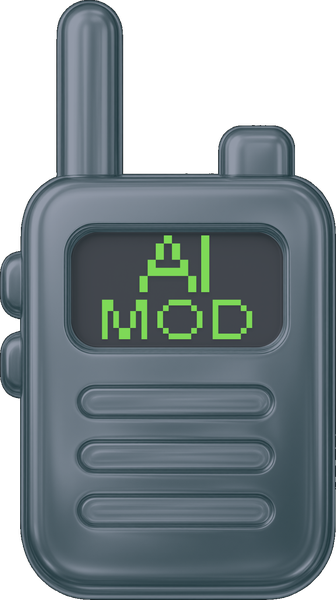

<p align="center"></p>

# AIMOD

AI pit strategy for **NASCAR Racing 2003 Season**. AIMOD takes over the AI cars' pit decisions while
you race or watch: when each car pits, what it takes (fuel amount, two or four tires, repairs), and how
teams react to each other, to cautions and to stage breaks. It also shows a broadcast-style pit board over
the game and can voice every car's crew chief and spotter as a race scanner.

AIMOD v2 is a rewrite of **AIMOD v1.0.4** by Adolfo Delgado. It keeps v1's memory map and reads the same
presets (v2 presets keep the v1 keys, so they still open in v1.0.4).

Download the latest release from the [Releases](../../releases) page. The README inside the zip is the
user guide (every setting is explained there and in the app's tooltips).

## AI use

AIMOD v2 was written with AI assistance (Claude, by Anthropic), working from Adolfo Delgado's v1.0.4 and
from live NR2003 sessions. Jonathon Thomas directed the work, ran the live tests and decided what shipped.
Memory addresses were found by probing the running game and by disassembling NR2003.exe; each one is
documented where it is defined, with how it was found. Features were checked in live races and by beta
testers, and bug reports were turned into regression tests (the test names say which race or report they
come from). Questions and bug reports are welcome in the issue tracker.

## What it does

- **Pit strategy per car.** Green-flag stops planned from each car's real fuel mileage and tire wear;
  short-pit / split / stretch stints; undercut and overcut reactions; team and manufacturer plans
  (including superspeedway blocks).
- **Fuel range options.** *Tank range extension* stretches the tank range used to decide whether a car can
  make the finish with one more stop; *Fuel pit level* sets how low a car runs before a fuel stop; *Aggressive
  green-flag fuel* (off by default) lets cars on good tires run the tank lower, between two levels you set.
  None of them change real fuel use.
- **Cautions.** Every caution call is AIMOD's: fuel, tires against track position, laps to go, the free
  pass and wave around, stage breaks, overtime (green-white-checkered). The game's own stop requests
  are called off when the car doesn't need the stop; penalties, heavy damage and an empty tank still
  go ahead.
- **Every trip down pit road is accounted for.** Stops the game commits to on its own are taken over or
  sent through without service, and logged with their real cause.
- **Crew chief adjustments.** At a stop an AI crew chief may adjust wedge, track bar, air pressure or
  grille tape; a good call improves the car's handling, a misread makes it worse (crew rating from the
  `.car` file).
- **Driver behavior and rivals (beta, off by default).** AI drivers save fuel or tires, push late in a
  stage, and race harder when it matters (late in a stage, for the lead, against a rival). Rivals are pairs
  you set, or grudges that build from run-ins during the race. This works through each driver's
  aggression value in memory; it gives closer racing, but it doesn't reliably cause deliberate contact yet.
  *Racing intensity* has an off / shadow (log only) / on mode and a strength setting, and a *side room* setting
  (70% by default, 100% = off): a driver in a battle keeps only part of his own room beside other cars, so side by
  side racing gets closer; every car goes back to his own values when the battle ends, the mode changes or AIMOD
  closes.
- **Clear AI black flags** (off by default). In a race, any penalty rule's black flag on an AI car is wiped from
  the game's memory the moment it shows, so no AI car is called in to serve one. Your car is never touched.
- **Pit crew and gearbox options** (memory only, game files are never changed): modern one-lug pit
  crews with faster fuel flow, and the game's own 5/6-speed gearbox for mods that want it.
- **Sound sets per series.** Pick a series and a loose-WAV sound set, press Apply with NR2003 closed. AIMOD backs up
  the game's loose sounds first, checks every WAV (PCM, 22050 Hz, 16-bit, right channel count), layers partial sets
  over the originals and only ever touches files it wrote. Restore puts the originals back. Add your own sound
  packs from a folder (none are bundled except NASCARMASTER's open-wheel crash sounds). A downloaded pack can be
  dropped straight into `sound_sets`: on Apply, 8-bit files and stereo files where the game wants mono are converted
  into a cache copy (the download is never changed), and files that can't be fixed are left out.
- **Race scanner.** Spoken team radio for one car or the whole field, with an on-screen card for the car
  that's talking; custom lines (rival and grudge calls included); optional phone playback.
- **Subtitle box and radio conversations.** An optional TV-style box over the game (number card, who is speaking,
  exactly what is said) for a few special calls: rivalries and grudges, big moments on the TV car, and your own
  scripted conversations; everything else keeps the plain number card. Write short back-and-forths between a
  driver, his crew chief and his spotter for any radio moment (Scanner tab > Conversations); each line plays in its
  own voice, one after another, in place of the moment's normal line.
- **Pit board and logs.** In-game pit board (windowed/borderless NR2003), a web/OBS widget, a CSV pit log
  per session and `aimod.log`.
- **Race results.** When a race ends, AIMOD saves an `.html` page and a `.json` file to its `results` folder:
  finishing order with points, stage results and stage points, laps led, fastest lap, average running position,
  pit stops, places gained, cautions and lead changes. It reads the game's lap crossings (nothing is written to
  the game), so it also works when you spectate. Points follow NASCAR's 2026 Chase scale (55 for a win, stage
  points, a fastest-lap point) and are unofficial; the start position is the running order at the first green flag.
  Turn it off with *Save race results* on the Pit log tab; *Open results folder* is next to it.
- **Works alone.** RaceControl (cautions, wave arounds, stages) and a companion overlay app are optional;
  AIMOD reads their files when they are there.

## Requirements

- Windows 10/11 and NASCAR Racing 2003 Season (the NR2003.exe build v1.0.4 supported).
- AIMOD runs as administrator, because NR2003 normally does and AIMOD reads and writes its memory.
- Before patching any code, AIMOD checks the original bytes; an unknown exe build switches it to read-only.

## Building from source

Python 3.12 on Windows:

```
pip install -r requirements.txt
build.cmd
```

`build.cmd` runs the tests, then builds `build\dist\AIMOD.exe` with `build\release\AIMOD.spec` (the spec
carries the hidden imports the scanner needs, so build from it rather than from the PyInstaller command
line). To run from source: `python main.py` from an administrator prompt.

Car number art and voices are not in this repository; they come with the release zip (or your own files).

## Tests

```
python -m unittest discover -s tests
python tools/sim_scenarios.py all
```

About 600 unit tests cover the strategy engine, the game-memory layer (against fake processes), presets,
the radio, driver behavior and the setup readers. `tests/racesim.py` is a whole-race simulator (fuel, tire falloff, pit
road, cautions, stages) used to check full-race outcomes: stops per car, laps down, fuel left at the
finish. Tests that read an installed NR2003 skip themselves when it isn't there.

## Layout

| Path | What's in it |
|---|---|
| `aimod/strategy.py` | The strategy engine: one tick per game update, decisions and memory writes per car |
| `aimod/game.py`, `aimod/memory_map.py` | Reading and writing NR2003's memory; every address with how it was found |
| `aimod/app.py` | The Tk app: settings, monitor, pit log, patches |
| `aimod/radio*.py`, `aimod/helmet.py` | Race scanner, voices and the on-screen card |
| `aimod/adjust.py`, `aimod/aisetup.py` | Crew chief chassis adjustments from the track's AI setup |
| `aimod/pitcrew.py`, `aimod/gearbox.py` | Pit crew and gearbox options (memory only) |
| `aimod/soundsets.py`, `sound_sets/` | Per-mod loose WAV sets and reversible file staging |
| `aimod/tiremodel.py`, `aimod/pace.py` | Learned tire falloff and pace per track |
| `aimod/behavior.py`, `aimod/aggression.py` | Driver behavior, racing intensity and rivals |
| `aimod/results.py` | Race results (`.json` + `.html`) from the game's lap crossings |
| `aimod/subtitles.py`, `aimod/subtitle_overlay.py` | When the subtitle box shows, radio conversations, and the box itself |
| `aimod/carfiles.py`, `aimod/carno.py` | `.car` files (teams, crew ratings) and car numbers ("01" is stored as 2001) |
| `tests/` | Unit tests and the race simulator |
| `tools/` | Live probes used to find and confirm memory addresses (`--fake` runs them against a fake game) |

## Credits

- **Adolfo Delgado**: original AIMOD (v1.0.4): memory map, pit takeover and strategy logic.
- **Jonathon Thomas**: AIMOD v2.

## License

MIT, see [LICENSE](LICENSE).
